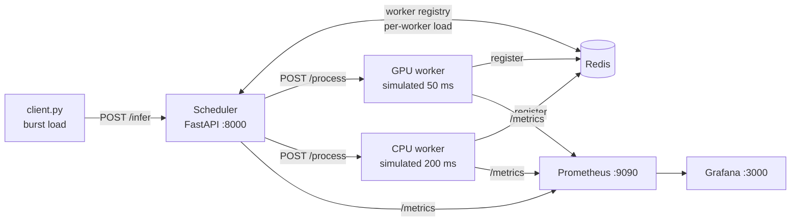

# ML Inference Scheduler

A load-aware scheduler that routes ML inference requests across mixed GPU and CPU workers, with shared state in Redis and metrics in Prometheus/Grafana.

## Problem

Inference fleets are rarely uniform. A few fast GPU workers sit beside slower CPU workers, and request volume arrives in bursts. Round-robin load balancing treats every worker as equal, so fast workers sit idle while queues build on slow ones. This project asks a narrow question: **what does a simple, observable, load-aware router look like, and where does it break?**

## Architecture



**Scheduling policy** (`scheduler_app.py`): read all registered workers and their in-flight load from Redis, sort each pool by load, send to the least-loaded GPU worker if it has capacity, otherwise the least-loaded CPU worker, otherwise return `503`. Load is incremented in Redis before dispatch and decremented in `finally`, so failures don't leak capacity.

**Metrics exported:** request count, end-to-end latency histogram, per-worker load, active workers by type, queue depth.

## Run it

Requires Docker with Compose and Python 3.9+ for the client.

```bash
git clone https://github.com/falakshair01/ml-inference-scheduler.git
cd ml-inference-scheduler
docker compose up --build -d
pip install -r requirements.txt
python client.py          # 500 requests at concurrency 30, writes request_results.json
```

- Scheduler: http://localhost:8000
- Prometheus: http://localhost:9090
- Grafana: http://localhost:3000 (default `admin`/`admin` on first login; change it)

## Results

Workers are **simulated** with fixed latencies (`SIM_LATENCY=0.05` for GPU, `0.20` for CPU), so results show scheduling behavior, not real model performance. Raw per-request output from a run is in `request_results.json`; dashboards and discussion are in the [write-up on Medium](https://medium.com/p/9d5575895c10).

## Known limitations

These are the next things I would fix, and the reasons the design is a prototype:

- **Race between check and increment.** Load is read, compared and then incremented in separate Redis calls, so concurrent requests can overshoot a worker's capacity. Fix: an atomic Lua script or `INCR`-then-check-and-rollback.
- **Blocking Redis client in async handlers.** `redis.Redis` blocks the event loop; `redis.asyncio` is the correct client.
- **Static capacity.** Every worker has a hard-coded capacity of 2 in-flight requests regardless of type.
- **No queueing.** When all workers are busy the scheduler returns `503` instead of holding the request.
- **Simulated hardware.** The natural next step is to replace the workers with real model servers (e.g. vLLM on GPU, ONNX Runtime on CPU) and measure p50/p99 latency and throughput against a round-robin baseline.

## Author

Falak Shair · [LinkedIn](https://www.linkedin.com/in/falak-shair-software-engineer) · [Medium](https://medium.com/@falakshair563)
